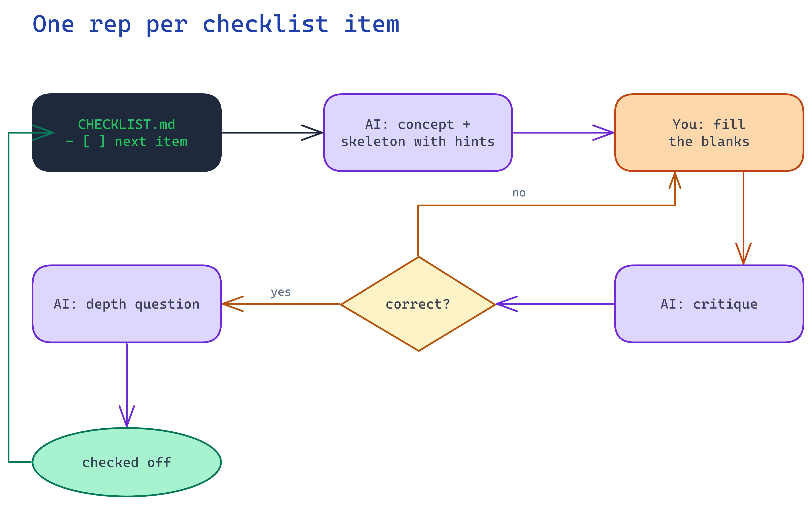
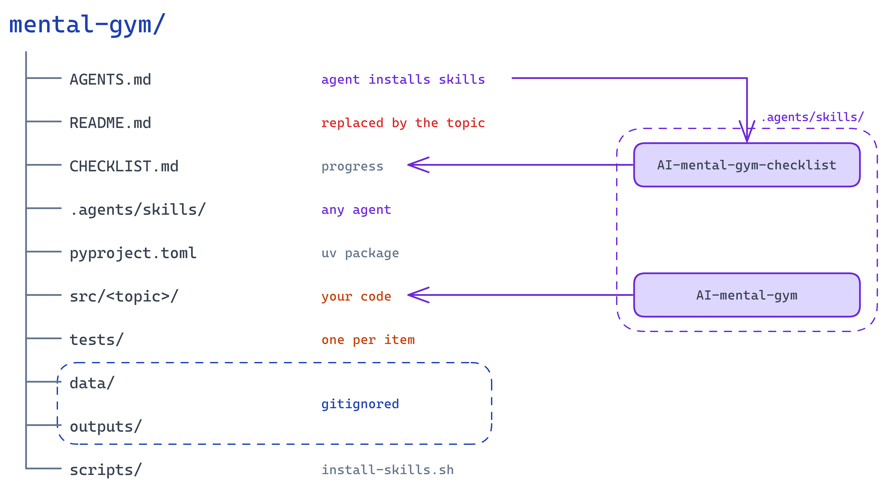

# mental-gym-jev

A [mental gym](https://github.com/lun-ai/skills) for building a Jev-style
"System One" model from scratch: a transformer that reads one shared state plus
several questions in a single forward pass and returns calibrated probability
distributions over typed answers (choice, boolean, numeric) instead of
generating tokens. Jev is TypeSafe's first System One model
([launch post](https://typesafe.ai/blog/introducing-system-one-models-and-jev)).

Reference implementation: none is public. The target design follows Archer
Hume's black-box reconstruction,
[Jev's architecture, unmasked](https://archerhume.com/posts/jevs-architecture-unmasked),
with the pieces grounded in prior art: Hydragen for shared-prefix attention,
FIRST for single-token listwise scoring, Guo et al. 2017 for calibration, and
Gneiting & Raftery 2007 for proper scoring rules. The backbone is a small
pretrained causal LM loaded from Hugging Face; everything that makes Jev
different from an LLM (branch attention, readout heads, calibrated training)
is built here.

Progress lives in [`CHECKLIST.md`](CHECKLIST.md). Blog post: TBD.

## Getting started

Open this repo in your coding agent: Claude Code, Codex, Gemini CLI, or any
other that reads `AGENTS.md`. Nothing to install by hand. `AGENTS.md` tells
the agent to install the gym skills from
[lun-ai/skills](https://github.com/lun-ai/skills) into this repo if they are
missing, generate `CHECKLIST.md` if it is still the stub, and then start
coaching. A good first message:

```text
Set up the gym.
```

Under the hood the agent runs `scripts/install-skills.sh`, which copies
`AI-mental-gym` and `AI-mental-gym-checklist` into `.agents/skills/`, the
cross-agent skills directory, and symlinks `.claude/skills` and
`.gemini/skills` to it. The copy is tracked in git, so anyone who clones the
repo gets the skills with it. Re-run the script to refresh them.

The same script tags the GitHub repo with the `mental-gym` topic (best
effort, needs `gh` logged in), so all gyms are grouped at
[github.com/topics/mental-gym](https://github.com/topics/mental-gym) and under
`topic:mental-gym` on the profile's repository filter.

## How the gym works

Say which checklist item you are on. The skill coaches one item at a time
without writing the solution for you.



Each checklist item is one rep: the AI scaffolds a skeleton with hints, you
fill the blanks, the AI critiques, then asks a depth question once it is
correct. The last item of a phase also triggers that phase's depth checkpoint.

## Layout



```
AGENTS.md        agent instructions: install skills, generate checklist, coach
CLAUDE.md        points Claude Code at AGENTS.md (GEMINI.md does the same)
.agents/skills/  the gym skills, installed by the agent, usable by any agent
CHECKLIST.md     phases, items and depth checkpoints
src/jev/         the code you write
tests/           unit tests per checklist item
data/            datasets (gitignored)
outputs/         generated artifacts (gitignored)
scripts/         install-skills.sh
docs/            diagrams (.excalidraw sources and rendered .png)
```

## Python setup

```
uv sync
uv run pytest
```
